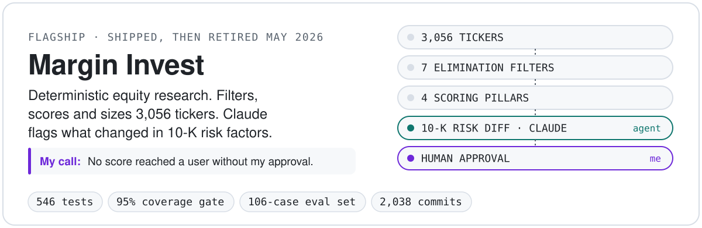
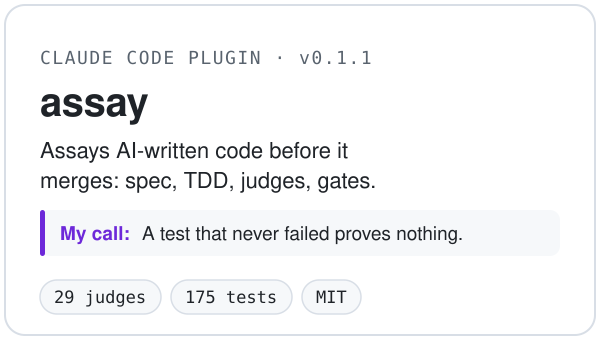
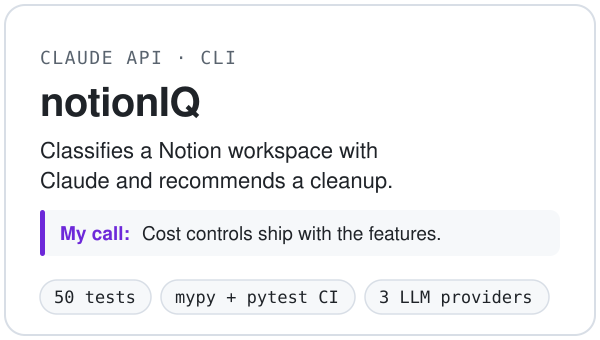
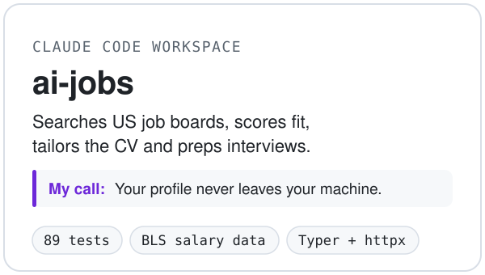
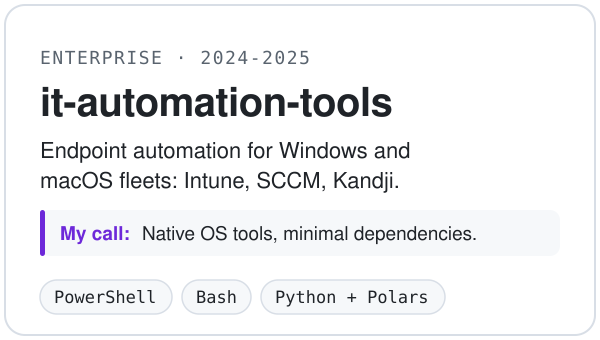

<picture>
  <source media="(prefers-color-scheme: dark)" srcset="assets/readme/hero-dark.svg">
  
</picture>

  
  

**Enterprise systems by background. AI engineering with evals and gates by practice.** I'm an Enterprise IT Systems Engineer (GCP, Workato, Google Workspace) moving full-time into AI engineering. I build with Claude Code as my pair and keep the judgment calls: what to build, how it is proven and what is allowed to ship.

## How I work

- **I own the decisions.** The problem, the spec, the architecture and when to stop. Margin Invest went live with a handful of test users, then I shut it down when the market was not there.
- **Agents build inside gates I set.** Spec, vertical slices, TDD with a captured failing test, a judge panel, then my approval before anything commits. I packaged that loop as [assay](https://github.com/ShadyBad/assay) and use it on my current work.
- **Evals decide what ships.** Golden sets with hand-labelled cases, LLM-as-judge with pinned prompts, and pass thresholds enforced in code.
- **Observable and typed by default.** Pydantic at the boundaries, lint and pytest gates in CI, cost metered per LLM call.
- **I learn the fundamentals by hand.** I work through a structured AI engineering curriculum writing the Python myself, so I can read, debug and own what agents produce.

## Work

<a href="https://github.com/ShadyBad/margin_invest"><picture><source media="(prefers-color-scheme: dark)" srcset="assets/readme/card-margin-invest-dark.svg"></picture></a> <a href="https://github.com/ShadyBad/assay"><picture><source media="(prefers-color-scheme: dark)" srcset="assets/readme/card-assay-dark.svg"></picture></a><a href="https://github.com/ShadyBad/notionIQ"><picture><source media="(prefers-color-scheme: dark)" srcset="assets/readme/card-notioniq-dark.svg"></picture></a> <a href="https://github.com/ShadyBad/ai-jobs"><picture><source media="(prefers-color-scheme: dark)" srcset="assets/readme/card-ai-jobs-dark.svg"></picture></a><a href="https://github.com/ShadyBad/it-automation-tools"><picture><source media="(prefers-color-scheme: dark)" srcset="assets/readme/card-it-automation-tools-dark.svg"></picture></a>

## Shipped with

Every row links to public code that uses it.

| Area | Tools | Proof |
|---|---|---|
| AI | Claude API (prompt caching, per-call cost metering), Voyage embeddings, LLM-as-judge evals, Claude Code skills, subagents, hooks and plugins | [margin_invest](https://github.com/ShadyBad/margin_invest), [assay](https://github.com/ShadyBad/assay), [notionIQ](https://github.com/ShadyBad/notionIQ) |
| Backend | Python 3.13, FastAPI, Pydantic, SQLAlchemy, Postgres, Redis + ARQ workers, Typer, httpx | [margin_invest](https://github.com/ShadyBad/margin_invest), [ai-jobs](https://github.com/ShadyBad/ai-jobs) |
| Frontend | Next.js, React, TypeScript | [margin_invest/web](https://github.com/ShadyBad/margin_invest/tree/main/web) |
| Quality | pytest, Ruff, mypy, coverage gates, GitHub Actions | [margin_invest](https://github.com/ShadyBad/margin_invest), [assay](https://github.com/ShadyBad/assay), [notionIQ](https://github.com/ShadyBad/notionIQ), [ai-jobs](https://github.com/ShadyBad/ai-jobs) |
| Ops | uv, Docker, Railway, Vercel, Sentry, PostHog | [margin_invest](https://github.com/ShadyBad/margin_invest) |
| Enterprise | GCP, Google Workspace, Workato, Intune, Kandji, PowerShell | day job, [it-automation-tools](https://github.com/ShadyBad/it-automation-tools) |

## Let's talk

I'm open to AI Engineer roles. The fastest way to reach me is [LinkedIn](https://linkedin.com/in/brandonpshay).

Built with Claude Code. Every claim on this page was checked against public code before it shipped.
