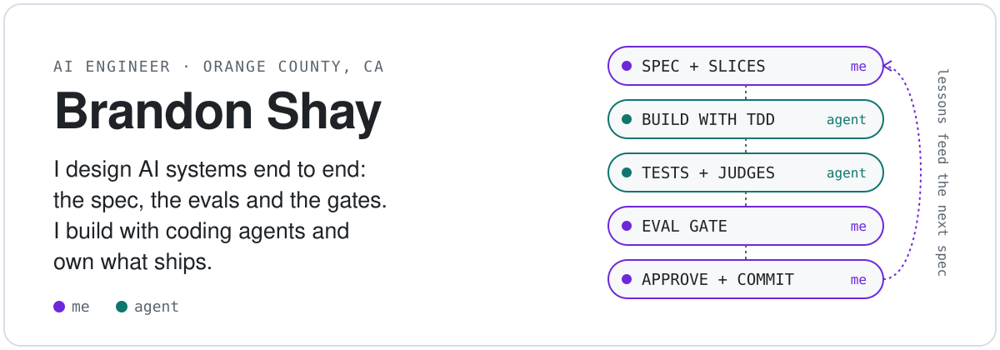
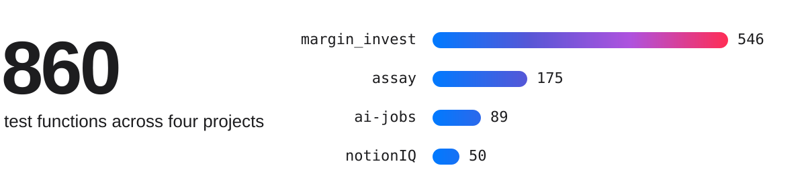
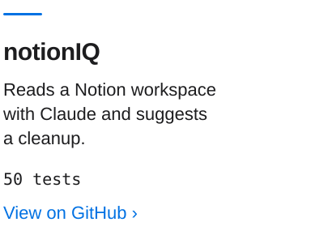
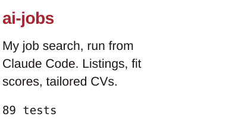
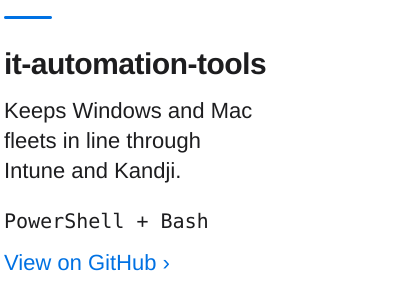

<picture>
  <source media="(prefers-color-scheme: dark)" srcset="assets/readme/hero-dark.svg">
  
</picture>

```python
brandon = {
    "role": "AI Engineer",
    "background": "Enterprise IT",
    "builds_with": "Claude Code",
    "owns": ["the spec", "the evals", "what ships"],
    "learning": "Python, by hand",
}
```

Orange County, CA. Open to AI Engineer roles.

<br>

<picture>
  <source media="(prefers-color-scheme: dark)" srcset="assets/readme/tests-dark.svg">
  
</picture>

<br>

### Margin Invest

Equity research across 3,056 tickers, with Claude reading 10-K risk factors for what changed. Nothing reached a user without my approval. I retired it in 2026 when the market wasn't there.

Every formula is pinned to a real filing.

```python
EXPECTED = {
    "gross_margin_2024": 0.4621,  # 180683 / 391035
    "revenue_growth": 0.0202,  # (391035 - 383285) / 383285
    "roa_2024": 0.2568,  # 93736 / 364980
}
```

[View on GitHub ›](https://github.com/ShadyBad/margin_invest)

<br>

### assay

A review gate for AI-written code. Spec first, tests first, up to 29 judges, then my sign-off.

```console
$ uv run pytest
386 passed, 7 skipped in 0.71s
```

[View on GitHub ›](https://github.com/ShadyBad/assay)

<br>

### Smaller tools

<p><a href="https://github.com/ShadyBad/notionIQ"><picture><source media="(prefers-color-scheme: dark)" srcset="assets/readme/tool-notioniq-dark.svg"></picture></a><a href="https://github.com/ShadyBad/ai-jobs"><picture><source media="(prefers-color-scheme: dark)" srcset="assets/readme/tool-ai-jobs-dark.svg"></picture></a><a href="https://github.com/ShadyBad/it-automation-tools"><picture><source media="(prefers-color-scheme: dark)" srcset="assets/readme/tool-it-automation-tools-dark.svg"></picture></a></p>

<br>

[LinkedIn ›](https://linkedin.com/in/brandonpshay)
